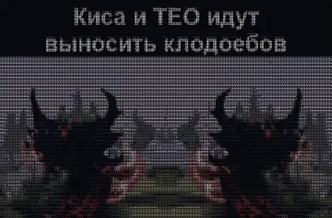

<p align="center">
  <a href="README.md"><strong>English</strong></a> ·
  <a href="README.ru.md">Русский</a>
</p>

# ✨ Fine Dots Backgrounds Pack for CanvasTTY

<p align="center">
  <strong>Curated collection of 21 animated Braille 2×4 subpixel matrix backgrounds for CanvasTTY terminals.</strong><br>
  🎮 21 Live Scenes · ⚡ Subpixel Matrix · 🪟 Windows · 🐧 Linux · 🍎 macOS<br>
  <a href="#-animated-gallery-collage">View Collage</a> ·
  <a href="#-installation">Installation</a> ·
  <a href="LICENSE">MIT License</a>
</p>

A high-performance animated backgrounds collection designed specifically for [CanvasTTY](https://github.com/howdeploy/CanvasTTY). All scenes are rendered in **Fine Dots** (Braille $2\times 4$ subpixel matrix, `0x2800..0x28FF`) providing smooth subpixel geometry and zero distortion without stretching or cropping.

---

## 🎨 Animated Gallery Collage

| Background | Background |
| :---: | :---: |
| <br><strong>Two Shadow Fiends: Theo & Kisa</strong><br><sub>Iconic synchronized Shadow Fiends swaggering walk with glowing fiery claws</sub> | <br><strong>Dancing Cats DJ</strong><br><sub>Energetic viral dancing cats loop grooving to the beat</sub> |
| <br><strong>Time to Lock In (Coding Cat)</strong><br><sub>Intense focused meme cat locked in for late-night programming</sub> | <br><strong>Komaru 2kg Salt Party</strong><br><sub>The legendary Komaru cat from the iconic salt party meme</sub> |
| <br><strong>Banana Komaru (Mmm Bananas)</strong><br><sub>Adorable Komaru cat dancing in a cute banana outfit</sub> | <br><strong>Eshkere Cats Choir</strong><br><sub>Meme cats dancing together in an upbeat synchronized circle</sub> |
| <br><strong>Hooded Cat: Okak</strong><br><sub>Cozy cat in a hoodie observing terminal logs</sub> | <br><strong>Curious Cat: Why</strong><br><sub>Thoughtful meme cat pondering why code works on the first try</sub> |
| <br><strong>Dancing Bear Babrikosk</strong><br><sub>Cheerful plush bear Babrikosk flexing and dancing non-stop</sub> | <br><strong>Spooky Skeletons Flex</strong><br><sub>Classic Halloween synchronized skeleton dance under stage lights</sub> |
| <br><strong>Discipline Phonk Routine</strong><br><sub>Motivational athlete silhouette with DISCIPLINE typography in cyber phonk style</sub> | <br><strong>Astronaut Lounging on Moon</strong><br><sub>Chilled astronaut relaxing on the Moon with scenic Earth view</sub> |
| <br><strong>Ginger Cat on the Hood</strong><br><sub>Tough ginger cat relaxing on a car hood under city neon lights</sub> | <br><strong>Neon Basketball Dunk</strong><br><sub>Powerful basketball slam dunk sequence in glowing purple neon</sub> |
| <br><strong>Sneaky Dark Voxel Golem</strong><br><sub>Sneaky voxel golem character pacing steadily through the dark</sub> | <br><strong>Living Room Kittens (Hookah)</strong><br><sub>Cozy evening neon living room vibe with cute relaxed kittens</sub> |
| <br><strong>Streamer Waving Hello</strong><br><sub>Friendly anime streamer silhouette waving hello from a neon city window</sub> | <br><strong>Orchestrator Checking /goal</strong><br><sub>Futuristic high-tech HUD scanner loop checking agent goals</sub> |
| <br><strong>Cozy Fireplace Cat</strong><br><sub>Cozy cat warming paws near a warm, flickering fireplace</sub> | <br><strong>Fisheye Shocked Cat</strong><br><sub>Hilarious wide-angle fisheye lens view of a stunned cat</sub> |
| <br><strong>My Reaction To That Information</strong><br><sub>Iconic retro pixel meme reaction loop</sub> |  |


---

## 🚀 Installation

### 1. In CanvasTTY (One Click)
1. Open **CanvasTTY** → **Settings** (`⚙`) → **Plugins**.
2. Search for `terminal-backgrounds` or `fine-dots`.
3. Click **Install**.
4. Open the plugin card on the canvas to browse, preview, and apply any background directly to your terminal windows!

### 2. Manual Clone
```bash
git clone https://github.com/CLOSETTTY/canvastty-plugin-terminal-backgrounds.git
```

---

## 🛠️ Technical Details

| Detail | Specification |
| :--- | :--- |
| **Rendering Engine** | Fine Dots (Braille $2\times 4$ subpixel matrix, 256 masks) |
| **Color Depth** | 256-color K-Means palette |
| **Ground Anchor** | `#07090f` (matches CanvasTTY dark terminal background) |
| **Aspect Fit** | Natural geometric contain mode (no stretching, round dots) |
| **Animation Rate** | Butter-smooth 15 FPS locked WebP / JSON streams |
| **Storage Format** | Compact RLE-compressed frame data (`data/*.json`) + JS module (`pieces/*.js`) |

---

## 📜 License

Released under the [MIT License](LICENSE) © 2026 CLOSETTTY.
