<p align="center">
  <a href="README.md"><strong>English</strong></a> ·
  <a href="README.ru.md">Русский</a>
</p>

# ✨ Fine Dots Backgrounds Pack for CanvasTTY

<p align="center">
  <strong>Curated collection of 35 animated Braille 2×4 subpixel matrix backgrounds for CanvasTTY terminals.</strong><br>
  🎮 35 Live Scenes · ⚡ Subpixel Matrix · 🪟 Windows · 🐧 Linux · 🍎 macOS<br>
  <a href="#-gallery--live-previews">View Gallery</a> ·
  <a href="#-installation">Installation</a> ·
  <a href="LICENSE">MIT License</a>
</p>

A high-performance animated backgrounds collection designed specifically for [CanvasTTY](https://github.com/howdeploy/CanvasTTY). All scenes are rendered in **Fine Dots** (Braille $2\times 4$ matrix, $0x2800..0x28FF$) providing smooth subpixel geometry and zero distortion without stretching or cropping.

---

## 🎨 Gallery & Live Previews

### ⚡ Cyberpunk & Neon

| Preview | Scene | Description |
| :---: | :--- | :--- |
| 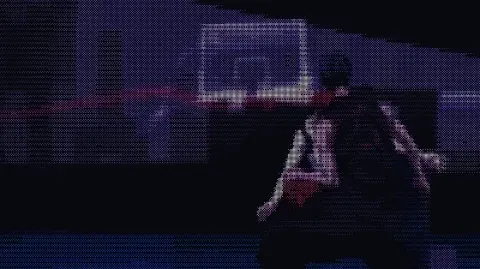 | **Neon Dunk**<br>`basketball-neon` | Эпичный баскетбольный бросок сверху в неоновом свечении |
| 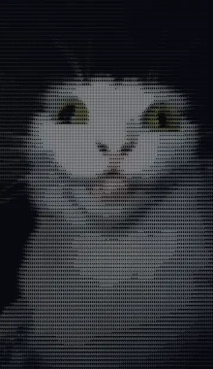 | **City Night Walk**<br>`city-night-walk` | Атмосферный пиксельный ночной мегаполис |
| 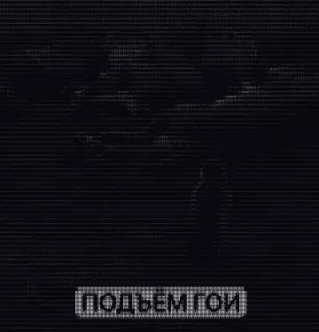 | **Cyber Glow**<br>`cyber-glow` | Плавные неоновые волны и футуристическая геометрия |
| 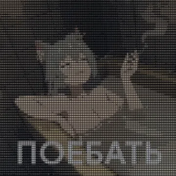 | **Cyber Samurai**<br>`cyber-samurai` | Силуэт кибер-самурая под неоновым дождём |
| 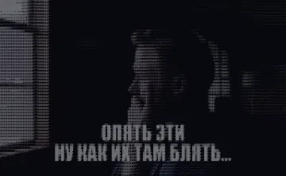 | **Glitch Dream**<br>`glitch-dream` | Психоделический неоновый глитч-арт |
| 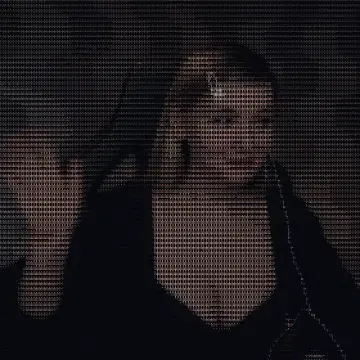 | **Neon Cityscape**<br>`neon-cityscape` | Ночной киберпанк-город с неоновой рекламой |
| 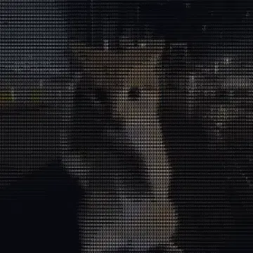 | **Neon Highway**<br>`neon-highway` | Бесконечная ночная трасса в лучах неона |

### 🌌 Space & Futurism

| Preview | Scene | Description |
| :---: | :--- | :--- |
| 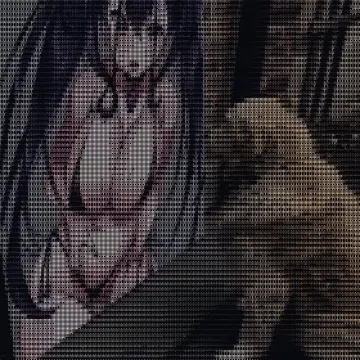 | **Cosmic Drift**<br>`cosmic-drift` | Астронавт, парящий в бескрайнем космосе |
| 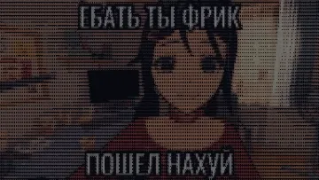 | **Geometric Loom**<br>`loom-animation` | Гипнотическое вращение световых струн |
| 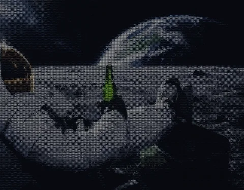 | **Moon Astronaut**<br>`moon-astronaut` | Астронавт на фоне Земли и лунного пейзажа |
| 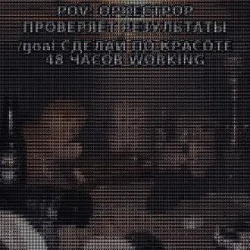 | **Tech HUD Loop**<br>`orchestrator-goal` | Футуристический высокотехнологичный HUD-интерфейс |
| 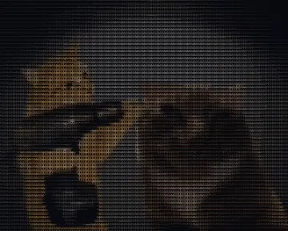 | **Sigma Geometry**<br>`sigma-loop` | Неоновый гипнотический цикл |
| 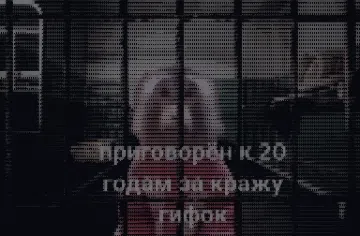 | **Vapor Clouds**<br>`vapor-clouds` | Плывущие пастельные неоновые облака |

### 🕹️ Retro & Pixel Art

| Preview | Scene | Description |
| :---: | :--- | :--- |
| 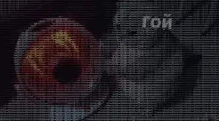 | **Aesthetic Drive**<br>`aesthetic-drive` | Неоновая ретро-поездка в закат 80-х |
| 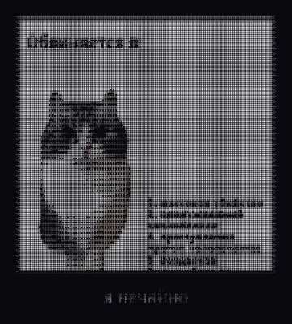 | **Pixel Horizon**<br>`demik-scene` | Ностальгический 8-битный пейзаж |
| 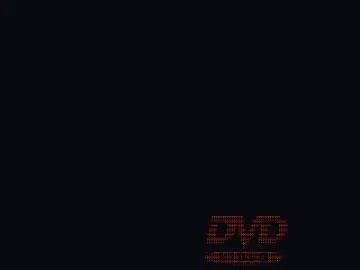 | **DVD Bounce**<br>`dvd-bounce` | Культовый логотип DVD, отскакивающий от углов экрана |
| 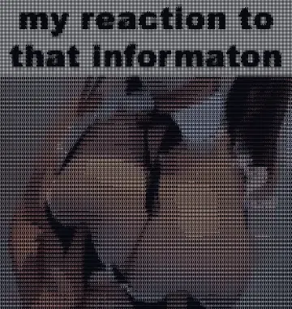 | **Pixel Loop**<br>`pixel-animation` | Уютная пиксельная анимация |
| 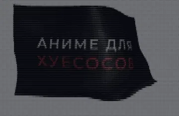 | **Pixel Runner**<br>`pixel-runner` | Бесконечный бег 8-битного кибер-раннера |
| 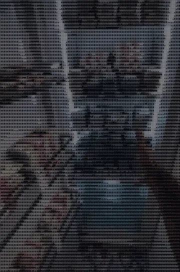 | **Outrun Grid**<br>`retro-drive` | Каркасная машина на сетке синтуэйва |
| 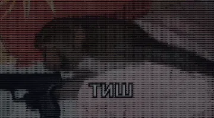 | **Synthwave Grid**<br>`retro-grid` | Бесконечный полёт над неоновой сеткой 80-х |
|  | **Voxel Golem**<br>`sneaky-golem` | Очаровательный шагающий голем |
| 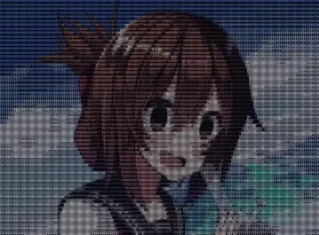 | **Synth Sunset**<br>`synth-sunset` | Огромное заходящее солнце над фиолетовыми горами |

### 🐱 Memes & Cute

| Preview | Scene | Description |
| :---: | :--- | :--- |
|  | **Dancing Bear**<br>`babrikosk-bear` | Забавный танцующий мишка Бабрикоск |
| 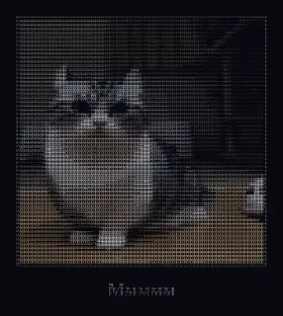 | **Banana Komaru**<br>`bananchiki-komaru` | Кошка Комару в банановом костюме |
| 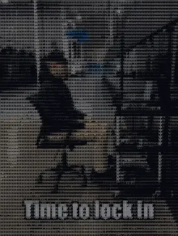 | **Cat Stare**<br>`cat-stare` | Мемный кот, внимательно смотрящий в экран |
| 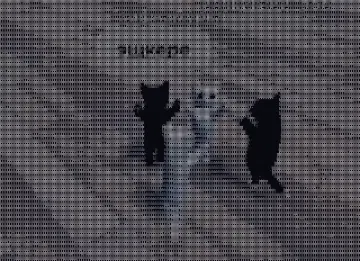 | **Eshkere Cats**<br>`eshkere-cats` | Мемные котики, танцующие под бит |
| 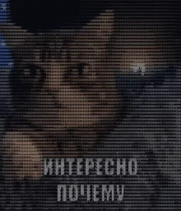 | **Interesting Meme**<br>`interesno-meme` | Забавный мемный диалог с котиком |
| 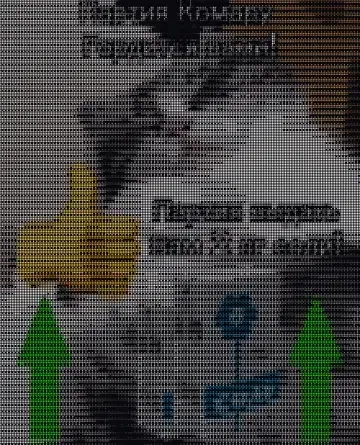 | **Komaru Cat**<br>`komaru-cat` | Легендарная кошка Комару в Брайль-матрице |
| 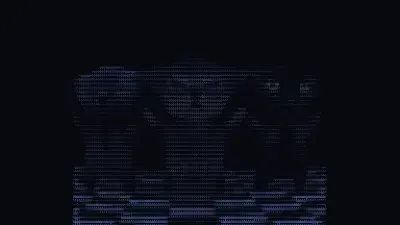 | **Dancing Cats**<br>`kotiki-tantsuyut` | Зажигательный танец котиков под музыку |
| 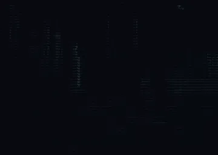 | **Oguzki Bezdari**<br>`oguzki-bezdari` | Культовый мем про шефа и поваров |
|  | **Okak Cat**<br>`okak-cat` | Удивлённый мемный кот Окак |
| 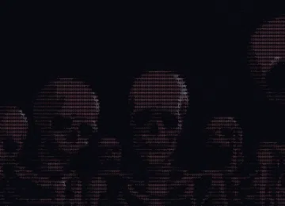 | **Skeleton Dance**<br>`skeleton-dance` | Знаменитый забавный танец скелетов |

### 🌸 Anime Aesthetic

| Preview | Scene | Description |
| :---: | :--- | :--- |
| 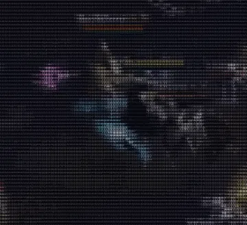 | **Anime Action**<br>`anime-action` | Динамичный ретро-аниме экшен в неоновых тонах |
| 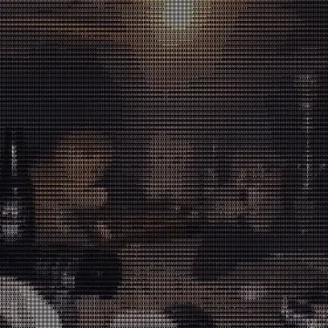 | **Girl in Rain**<br>`anime-girl-rain` | Атмосферный силуэт девушки с зонтом под дождём |
| 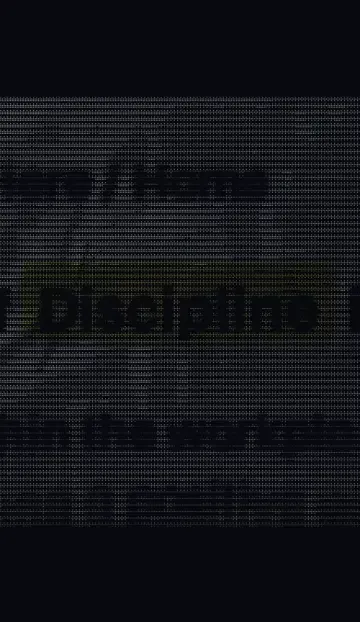 | **Discipline Routine**<br>`discipline-routine` | Мотивирующий цикл тренировки в кибер-стиле |

---

## 🚀 Installation

### 1. In CanvasTTY (One Click)
1. Open **CanvasTTY** → **Settings** (`⚙`) → **Plugins**.
2. Search for `terminal-backgrounds` or `fine-dots`.
3. Click **Install**.
4. Open the plugin card on the canvas to browse, preview, and apply any background directly to your terminal windows!

### 2. Manual Clone
```bash
git clone https://github.com/CLOSETTTY/canvastty-plugin-terminal-backgrounds.git
```

---

## 🛠️ Technical Details

| Detail | Specification |
| :--- | :--- |
| **Rendering Engine** | Fine Dots (Braille $2\times 4$ subpixel matrix, 256 masks) |
| **Color Depth** | 256-color K-Means palette |
| **Ground Anchor** | `#07090f` (matches CanvasTTY dark terminal background) |
| **Aspect Fit** | Natural geometric contain mode (no stretching, round dots) |
| **Storage Format** | Compact RLE-compressed frame data (`data/*.json`) + JS module (`pieces/*.js`) |

---

## 📜 License

Released under the [MIT License](LICENSE) © 2026 CLOSETTTY.
